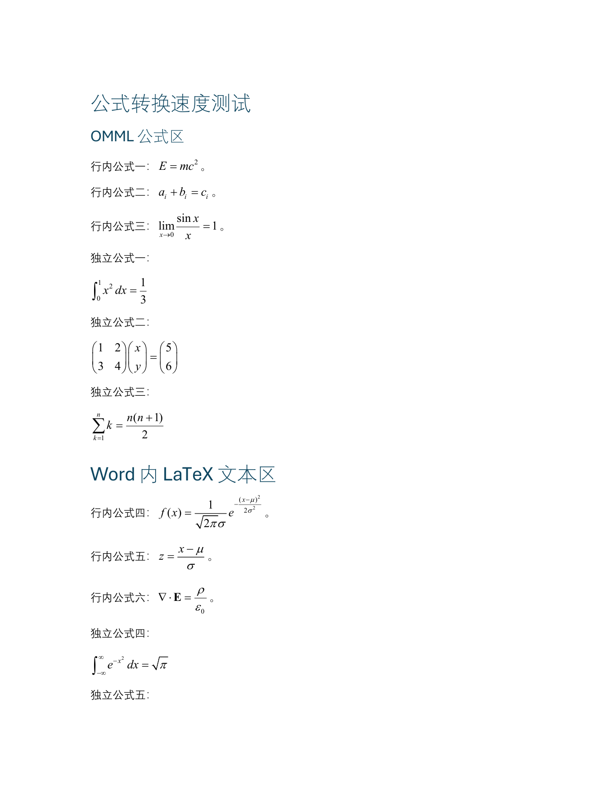
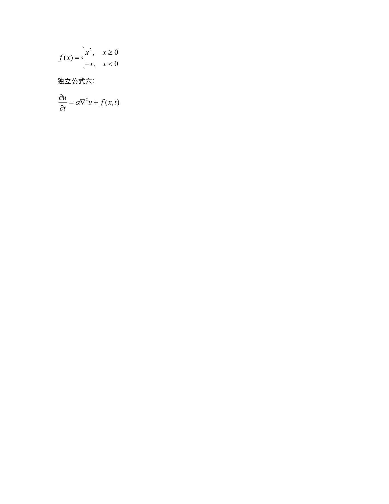

# Formula Conversion Speed Test

This directory contains a reproducible 12-formula Word test and the measured
results from the final `word-formula-mathtype` implementation.

## Test machine

| Component | Version |
| --- | --- |
| OS | Windows 11, 10.0.22631 |
| Windows PowerShell | 5.1.22621.6133 |
| Microsoft Word | Office 2021, 16.0.20527.20088 |
| MathType | 7.12.3 |
| Python | 3.12.3 |
| Pandoc | 3.9 |
| OCR model | SenseNova `sensenova-6.8-flash-lite` |

The mandatory preflight returned `PREFLIGHT: PASS`.

## Test document

- 12 formulas total
- 6 inline formulas and 6 display formulas
- 6 existing OMML equations
- 6 literal LaTeX formulas in Word text
- Fractions, roots, matrices, integrals, sums, limits, cases, partial
  derivatives, and Greek letters

## Results

| Metric | Result |
| --- | ---: |
| Converted successfully | 12/12 |
| Final MathType objects | 12 |
| Remaining OMML | 0 |
| Remaining formula delimiters | 0 |
| Remaining raw LaTeX paragraphs | 0 |
| External end-to-end time | 23.881 s |
| Script-internal time | 21.3 s |
| Average per formula | 0.700 s |
| Word/Pandoc/finalization overhead | about 12.9 s |

The external timer includes launching a nested PowerShell process, mandatory
preflight, Word startup, Pandoc extraction, conversion, cleanup, and saving.
The per-formula time is taken from the conversion log.

## Files

| File | Description |
| --- | --- |
| [`source.md`](source.md) | Readable source text for all formulas |
| [`input.docx`](input.docx) | Test input Word document |
| [`output-mathtype.docx`](output-mathtype.docx) | Output with 12 MathType OLE objects |
| [`output-mathtype.pdf`](output-mathtype.pdf) | Exported PDF for visual inspection |
| [`conversion-log.json`](conversion-log.json) | Per-formula conversion log |
| [`preflight-result.json`](preflight-result.json) | Machine-readable preflight result |
| [`preflight-and-conversion-console.txt`](preflight-and-conversion-console.txt) | Preflight and conversion console output |
| [`preview-page-1.png`](preview-page-1.png) | Rendered output page 1 |
| [`preview-page-2.png`](preview-page-2.png) | Rendered output page 2 |

## Reproduce

```powershell
powershell -ExecutionPolicy Bypass -File scripts/convert_any_formula_to_mathtype.ps1 `
  -SourcePath "examples/formula-speed-test/input.docx" `
  -TargetPath "examples/formula-speed-test/output-mathtype.docx" `
  -Mode Auto `
  -LatexMode Delimited `
  -ImagePolicy None `
  -Force
```

Verification:

```powershell
powershell -ExecutionPolicy Bypass -File scripts/verify_mathtype.ps1 `
  -Path "examples/formula-speed-test/output-mathtype.docx"
```

## Preview

### Page 1



### Page 2


